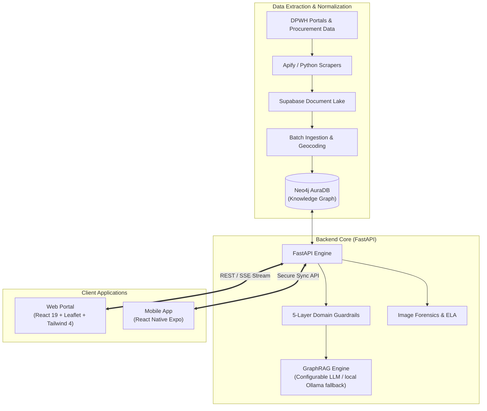

# ProjectTrack

> **Civic Intelligence and Transparency Engine for DPWH Infrastructure Projects Across Cebu**  
> *Transforming fragmented public civil works data into verifiable, geospatial, and graph-powered community intelligence.*

**Live Web Application:** [https://projecttrack.pages.dev/](https://projecttrack.pages.dev/)

[](https://github.com/kaids77/ProjectTRACK/actions/workflows/ci.yml)
[](https://github.com/kaids77/ProjectTRACK/actions/workflows/security-audit.yml)
[](LICENSE)
[](#)
[](https://python.org)
[](https://fastapi.tiangolo.com)
[](https://react.dev)
[](https://vite.dev)
[](https://neo4j.com)
[](https://leafletjs.com)

---

## Executive Summary

Every fiscal year, billions of Philippine Pesos are allocated for Department of Public Works and Highways (DPWH) civil works projects across the country. Citizens, watchdog organizations, journalists, and local governments routinely encounter structural transparency barriers:

* **Opaque Project Statuses**: Difficulty in independently verifying execution progress and tracking completion timelines.
* **Information Fragmentation**: Procurement notices, allocation records, and contractor track records reside in separate, non-relational databases.
* **Absence of Ground-Truth Validation**: Vulnerability to off-site photo submissions and lack of mandatory physical proximity checks during on-site documentation.

**ProjectTrack** addresses these systemic challenges for the Province of Cebu across all **53 Local Government Units (LGUs)** (44 municipalities and 9 cities). By combining automated web scraping, Neo4j knowledge graphs, tamper-evident image forensics, geofenced mobile verification, and a domain-guarded GraphRAG assistant, ProjectTrack converts raw public disclosures into structured, accessible civic intelligence.

---

## System Features

### Web Platform (`Website`)
* **Interactive Cebu Geospatial Map**: Renders vector boundaries for all 53 LGUs down to barangay levels without relying on heavy satellite tile streaming, displaying status-coded markers. Overlapping projects are grouped by zoom-aware proximity clustering, and the map stays synchronized with the chat - flying to a selected LGU or zooming to and highlighting a single project for superlative/locating questions (e.g. the most expensive, the latest, or the **most reported** project — province-wide or within a named LGU). A Report Verification legend filters the map by citizen-report tone — On-Site Verified, Photo Flagged, or **All Anomalies** (every project carrying any citizen report, rendered with white/grey pins) — and the whole interface supports a persisted **light/dark theme** toggle with theme-aware navigation.
* **GraphRAG-Powered AI Assistant ("ProjectTrack Watchdog")**: Contextual natural language query engine grounded in the Neo4j knowledge graph, with domain guardrails and a configurable, server-side LLM provider (vendor identifiers are never surfaced in the UI). Answers are structured around the WHAT / WHERE / WHO / WHEN / WHY / HOW of a project using only grounded facts, and "most reported" rankings are computed from the citizen field-report store so the chat always agrees with the map legend. Supports conversational memory for follow-ups ("tell me more about it", "what about in Cordova?") via a sandboxed, whitelist-validated reference resolver that stays strictly database-locked and injection-safe. User input and conversation history are sanitized and screened for prompt-injection before reaching the model.
* **Two-Stage Browser Geolocation with Diagnostics**: High-accuracy GPS capture with a coarse cache-tolerant Wi-Fi/IP fallback and explicit failure reason reporting, enabling reliable on-site geofence validation with in-place retry controls.
* **Image Forensics Verification**: Citizen-submitted photo evidence is screened server-side with Error Level Analysis (ELA) and perceptual hashing (pHash) to detect digital manipulation or image recycling; flagged reports surface a "Photo Flagged" badge in the UI.
* **Citizen Anomaly Reports with Verification Badging**: The report modal captures browser GPS at submission time; the backend runs a Haversine geofence check against official project coordinates and the UI renders a "On-Site Verified" / "Unverified" / "Photo Flagged" badge with distance and timestamp for every community report.
* **Turnkey APK Distribution**: Centered "Get an App" header button serving direct standalone Android APK downloads with fallback to official GitHub Releases.
* **Budget and Expenditure Transparency**: Real-time auditing of allocated funds, expenditure disbursements, variance indicators, and source funding across municipalities.
* **Automated Data Aggregation**: Continuous extraction and normalization of DPWH civil works registries and PhilGEPS procurement bulletins into a unified data store, with an optional passive scheduler that automatically re-scrapes and re-syncs on a recurring interval (default every ~3 months) so a deployed instance stays current without manual intervention.

### Mobile Field Auditor (`mobile` — React Native with Expo)
* **Geofenced On-Site Photo Capture**: Uses React Native and Expo (`expo-location`, `expo-camera`) to confirm the device is within ≤150m of the project's DPWH coordinates before the live camera shutter unlocks (gallery uploads disabled for ground-truth integrity).
* **Dual-Tier Vector GIS & Barangay Cartography**: High-performance SVG vector cartography and hardware-accelerated MapLibre GIS. Dynamically renders all 53 municipal boundaries at low-to-mid zoom and activates detailed barangay-level vector polygons (`cebuBarangays.json`) at high zoom (~Zoom 12+), complete with boundary strokes, selection highlights, golden ring pin accents, red anomaly hotspots, and cold-start retry resilience.
* **Spatial Coordinate Normalization & Polygon Clipping**: Bounding-box sanitization and geometry clipping for Cebu Province (mainland, Bantayan, Camotes) with automatic rejection of off-island coordinates across the Bohol and Tañon straits.
* **Server-Verified Submission & Badging**: Captured audits are submitted to `/api/reports`, re-validated server-side (geofence + image forensics), and the returned verdict — status, distance, forensics result, reputation — is shown on-device.
* **Native Session Persistence**: OS keystore storage via `expo-secure-store` sending Bearer headers on all authenticated calls, with deep-link OAuth callback support (`projecttrack://auth/callback`).
* **Offline-First Background Sync**: Audits captured offline are queued in a local outbox and synced to the backend when connectivity returns.
* **Automated Standalone APK Builds**: EAS cloud build workflow aligned with Android build version 9 (Kotlin 1.9.25 / Jetpack Compose Compiler 1.5.15) generating standalone Android binaries.

### Core Backend and Services (`backend`)
* **Personnel and Entity Graph Mapping**: Models relationships between contractors, authorized managing officers, district engineers, and procurement awards into a traversable graph.
* **Spatial Data Integrity**: Exact, canonicalized municipality matching eliminates cross-LGU leakage, and a polygon reverse-geocoding pipeline reassigns each project to the LGU that actually contains its authentic DPWH coordinates (projects outside Cebu are flagged and excluded).
* **Supabase Authentication**: Backend-managed Supabase (GoTrue) auth under `/api/auth` (OAuth, email/password, session, sign-out) with HTTP-only session cookies, auto token refresh, and a reusable route-guard dependency - ready for the web and mobile clients to hook into.
* **High-Throughput RESTful and SSE API**: Production-grade FastAPI endpoints supporting sub-20ms instant Cypher queries, Server-Sent Events (SSE) streaming, and standardized GeoJSON feeds.
* **Field Report Verification API**: `/api/reports` endpoints enforce the four verification pillars server-side — a ≤150m geofence check against authentic DPWH coordinates, ELA + perceptual-hash image forensics, authenticated submission with a 3-reports/day limit and reputation scoring, and a verification verdict (status, distance, forensics, reputation) surfaced to both clients. Reports persist to Supabase Postgres + Storage with a lightweight Neo4j `:Report` node.

---

## System Architecture



---

## Quick Start Guide

### Live Application (Instant Evaluation)

ProjectTrack is deployed and ready for online evaluation without local installation:

* **Production Web Portal**: [https://projecttrack.pages.dev/](https://projecttrack.pages.dev/)
* **Android Field App (APK)**: Direct download available via the web portal's **"Get an App"** button or from [GitHub Releases](https://github.com/kaids77/ProjectTRACK/releases/latest)

For local setup and source code evaluation, follow the instructions below:

### 1. Prerequisites
* Python 3.10 or higher
* Node.js 18 or higher with npm
* Git

### 2. Backend Setup
```bash
# Navigate to backend directory
cd backend

# Create and activate virtual environment
python -m venv venv
# Windows: .\venv\Scripts\Activate.ps1 | Linux/macOS: source venv/bin/activate

# Install dependencies
pip install -r requirements.txt

# Configure environment variables
cp .env.example .env

# Start FastAPI application
python -m uvicorn backend.app:create_app --factory --reload --port 8000
```
The REST API will be accessible at `http://localhost:8000` (Interactive documentation at `http://localhost:8000/docs`).

### 3. Website Setup
```bash
# Open a new terminal and navigate to Website directory
cd Website

# Install frontend dependencies
npm install

# Start development server
npm run dev
```
The web dashboard will be available at `http://localhost:5173`.

---

## Documentation Hub

Comprehensive architectural, technical, and operational documentation is maintained in the [`docs/`](docs/) directory:

| Document | Description |
| :--- | :--- |
| [**01. Getting Started**](docs/01-getting-started.md) | Setup walkthrough, 3-minute guided evaluation tour, and verification steps. |
| [**02. Architecture & Pipelines**](docs/02-architecture.md) | System topology, GraphRAG data pipeline, guardrail mechanics, and forensic verification. |
| [**03. Tech Stack Justification**](docs/03-tech-stack.md) | Engineering justifications for Neo4j, FastAPI, React 19, Leaflet, and MiMo. |
| [**04. Comprehensive Setup Guide**](docs/04-setup-guide.md) | Production provisioning, Neo4j Aura cloud configuration, and deployment topology. |
| [**05. API Reference**](docs/05-api-reference.md) | Endpoint specifications, JSON request/response contracts, and SSE streaming schemas. |
| [**06. Development Roadmap**](docs/06-roadmap.md) | Phased milestones, barangay polygon rendering, and community initiative integration. |
| [**07. Security Architecture**](docs/07-security.md) | Threat modeling, 5-layer domain guardrails, digital forensics, and privacy protection. |

---

## Repository Structure

```text
ProjectTrack/
├── README.md                            <-- Project overview and system architecture
├── CONTRIBUTING.md                      <-- Contribution workflow and coding standards
├── CODE_OF_CONDUCT.md                   <-- Contributor Covenant community standards
├── SECURITY.md                          <-- Vulnerability reporting and threat policy
├── LICENSE                              <-- MIT Open-Source License
├── .github/                             <-- CI/CD workflows, issue and PR templates
├── docs/                                <-- Central technical documentation
│   ├── 01-getting-started.md
│   ├── 02-architecture.md
│   ├── 03-tech-stack.md
│   ├── 04-setup-guide.md
│   ├── 05-api-reference.md
│   ├── 06-roadmap.md
│   └── 07-security.md
├── Website/                             <-- React 19 + Leaflet geospatial web platform
├── mobile/                              <-- React Native Expo field auditor app (live backend data)
└── backend/                             <-- FastAPI, Neo4j GraphRAG, and scraping pipeline
```

---

## Open-Source Community and Governance

ProjectTrack is maintained under an open-source model to advance civic technology, data transparency, and public accountability.

* **Contributing**: Review [CONTRIBUTING.md](CONTRIBUTING.md) for branching strategy, commit conventions, and pull request guidelines.
* **Code of Conduct**: Adherence to the [CODE_OF_CONDUCT.md](CODE_OF_CONDUCT.md) is expected across all project channels.
* **Security & Responsible Disclosure**: Read [SECURITY.md](SECURITY.md) before reporting vulnerabilities.
* **Issue Tracking**: Report technical defects or submit architectural proposals through our [GitHub Issue Templates](.github/ISSUE_TEMPLATE/).
* **CI/CD**: Automated lint, test, and security audit workflows run on every push and pull request via [GitHub Actions](.github/workflows/).

---

## License

This project is licensed under the **MIT License**. Refer to the [LICENSE](LICENSE) file for complete terms and copyright notices.
