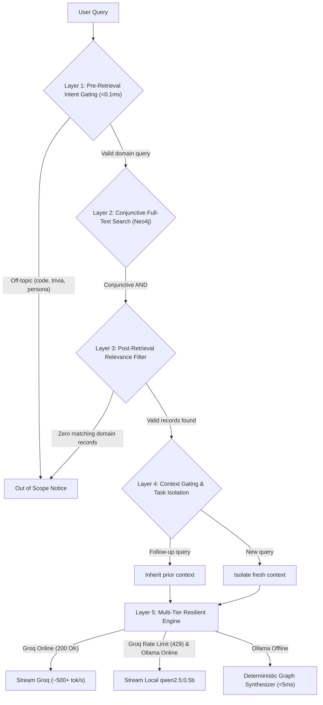

# DPWH Cebu Infrastructure Knowledge Graph and QA System

An end-to-end GraphRAG pipeline for scraping, ingesting, analyzing, and querying **4,370+ DPWH civil works projects** across Cebu Province (2022 – Present).

Built with **Neo4j Aura (Knowledge Graph)**, **Supabase (Document Lake)**, **Apify (Web Scraper)**, and **Groq (`qwen/qwen3.8-27b`)** with **Multi-Tier Fallback Resilience** for ultra-fast, zero-crash grounded AI question answering with multi-layer domain guardrails.

---

## Key Features

* **Sub-20ms Graph Traversal**: Direct Cypher queries and full-text index lookups across 4,370+ DPWH projects, contractors, budgets, and locations in Cebu.
* **5-Layer Domain Guardrails**: Bulletproof domain lock that intercepts programming questions, generic dictionary definitions, persona overrides (`act as a teacher`), and off-topic queries in `<0.1ms` before hitting Neo4j or the LLM.
* **Prompt-Injection Hardening**: Every user message and client-supplied history turn is normalized before the guardrail (NFKC folding, zero-width / bidi / control-character stripping, whitespace de-flooding, length cap). The intent gate blocks common injection phrasings (ignore/disregard/forget previous instructions, persona and developer-mode jailbreaks, prompt exfiltration, and chat-template delimiters like `</system>` or `<|im_start|>`), and instruction-override content planted in history is rejected too.
* **Supabase Authentication (Backend-Managed)**: Ready-to-use `/api/auth` endpoints (OAuth URL, callback, session, sign-in, sign-up, sign-out) backed by Supabase GoTrue. Tokens are kept in an HTTP-only session cookie and auto-refreshed; a `get_current_user` dependency guards protected routes. Native clients (mobile APK) receive `SessionTokens` in the response body and authenticate via `Authorization: Bearer` and `X-Refresh-Token` headers, validated against `MOBILE_APP_SCHEMES` (`projecttrack`, `exp`) for OAuth redirect URIs.
* **Multi-Tier Fallback Resilience (100% Uptime / Zero Crash)**:
  * **Tier 0 (Primary Cloud AI)**: Groq LPU running `qwen/qwen3.8-27b` delivering ~500+ tok/s response speed with situational token budgeting.
  * **Tier 1 (Offline Local AI Fallback)**: Lightweight local model **`qwen2.5:0.5b` (~398 MB)** via Ollama, accessible via 1-command installer (`python cli.py --setup-local-ai`).
  * **Tier 2 (Instant Graph Deterministic Synthesizer)**: Zero-token, sub-5ms fact synthesizer that computes fluent, plain-English engineering summaries directly from Neo4j facts when external LLMs hit rate limits (HTTP 429) or are offline.
* **1-Command Permission-Gated Local AI Setup**:
  * Run `python cli.py --setup-local-ai` to configure local Ollama and pull `qwen2.5:0.5b` (~398 MB, <600MB RAM, CPU-friendly).
  * Always prompts the user for explicit permission (`[y/N]`) before installing or downloading anything.
* **Batch Geocoding & Mapping**:
  * Run `python cli.py --geocode` to batch-geocode all Neo4j location and project nodes with verified WGS84 coordinates.
* **Instant Cypher Mode (Zero AI Needed)**: Full instant lookup cards, analytics, and full-text search run purely on Neo4j Aura in `<10ms`—no local LLM or API keys required.
* **Conversational Memory**: Context-aware follow-ups that remember the prior topic (a location, e.g. "tell me more about it" after "projects in Cordova", or a project). A deterministic heuristic handles common cues; a sandboxed, whitelist-validated LLM reference resolver handles ambiguous phrasing while staying strictly DB-locked and injection-safe.
* **Spatial Answer Targeting**: Location questions fly the map to the LGU; singular/superlative follow-ups ("what's the most expensive one?", "where is it located?", "most reported in Cordova?") zoom to that one project and highlight its pin. Superlative intent is inherited across location switches ("what about in Cordova?"). Report-volume superlatives ("most reported" / "most flagged") are ranked from the citizen field-report store (Supabase) so the chat agrees with the map's Report Verification legend.
* **Grounded 5W+H Answers**: In `ai` mode, grounded answers are organized around a project's WHAT (scope), WHERE (location), WHO (contractor + implementing office), WHEN (timeline + status), WHY (public benefit inferred from the project's own category/scope), and HOW (funding/budget and citizen-report activity) — using only facts in the retrieved context, with no outside knowledge and no server-side vendor identifiers surfaced to the UI.
* **Instant Graph Analytics**: Sub-millisecond aggregation calculates total budget, contractor rankings, project counts, and sector breakdowns directly from graph relationships.
* **Field Report Verification (`/api/reports`)**: Authenticated citizen reports with a server-authoritative ≤150m geofence check (Pillar 1), ELA + perceptual-hash image forensics against prior photos (Pillar 2), a 3-reports/day limit with reputation scoring (Pillar 3), and verification badging surfaced to web/mobile (Pillar 5). Rows and photos persist to Supabase Postgres + Storage; a lightweight `:Report` node is linked in Neo4j. Apply `supabase/migrations/*.sql` (see `supabase/README.md`).

---

## Repository Structure

```text
backend/
├── backend/                    # FastAPI REST & SSE Streaming Backend
│   ├── app.py                 # FastAPI application factory, CORS, lifespan & error handlers
│   ├── config.py               # Pydantic Settings configuration
│   ├── setup_local_ai.py       # 1-command permission-gated local AI installer (qwen2.5:0.5b)
│   ├── api/                    # Modular routes (auth, projects, analytics, chat, pipeline, health)
│   ├── models/                 # Pydantic data schemas
│   ├── services/               # Services:
│   │   ├── neo4j_service.py    # Connection pool & Cypher queries
│   │   ├── supabase_auth.py # Supabase GoTrue auth client (OAuth/password/session)
│   │   ├── guardrail_service.py# Pre-retrieval classifier & stream rail
│   │   ├── llm_service.py      # Multi-tier LLM execution (Groq -> Ollama -> Synthesizer)
│   │   ├── graph_synthesizer.py# Instant Graph Deterministic Synthesizer (<5ms)
│   │   └── pipeline_service.py # Background job execution & state tracker
│   └── tests/                  # Test suite (55 unit & integration tests)
│       ├── test_api.py         # API, guardrails & chat tests (33 tests)
│       ├── test_auth.py        # Supabase auth endpoint tests (12 tests)
│       ├── test_pipeline_enrichment.py # DPWH metadata, PhilGEPS & GAA ingestion tests (13 tests)
│       └── test_fallback.py    # LLM fallback & synthesizer tests (5 tests)
├── run.py                      # Start the web API server: `python run.py`
├── cli.py                      # Master CLI (interactive menu, queries, analytics, --sync, --scrape)
├── pipeline/                   # Core modular pipeline package
│   ├── __init__.py             # Unified package exports
│   ├── scrape_cebu_dpwh.py     # BetterGov scraper -> Apify & Supabase (full structured metadata)
│   ├── sync_to_neo4j.py        # Paginated batch ingestion -> Neo4j Aura (metadata-first + FundingSource)
│   ├── fetch_philgeps.py       # PhilGEPS procurement fetch + conservative Neo4j ingestion
│   ├── fetch_gaa.py            # GAA (appropriations) fetch + Neo4j ingestion
│   ├── geocoding.py            # Deterministic WGS84 geocoding engine
│   ├── enrich_neo4j_gps.py     # Authentic DPWH/BetterGov GPS enrichment
│   ├── lgu_boundaries.py       # Point-in-polygon LGU reverse-geocoder
│   ├── correct_municipalities.py # Reassign projects to the LGU that contains their coordinates
│   └── query_graph.py          # Cypher queries, Guardrails, Instant Insights & Streaming QA
├── .env.example                # Template for required environment variables
├── requirements.txt            # Python dependencies (FastAPI, Uvicorn, Neo4j, HTTPX, Pillow/imagehash/numpy for forensics)
└── Readme.md                   # Complete installation, usage & architecture guide
```

---

## Prerequisites

1. **Python 3.10+** (Tested on Python 3.10, 3.11, 3.12)
2. **Git**
3. Free Accounts / Services for:
   * **[Neo4j AuraDB](https://neo4j.com/cloud/platform/aura-graph-database/)** (Free cloud graph database instance)
   * **[Groq Cloud](https://console.groq.com/keys)** (Free ultra-fast LLM inference API)
   * **[Ollama](https://ollama.com/)** (Optional: only needed for offline local AI summaries; installable via `python cli.py --setup-local-ai`)
   * **[Supabase](https://supabase.com/)** (Required for authentication and field reports; optional only if you also sync/scrape)
   * **[Apify](https://apify.com/)** (Optional: only needed if running the scraper)

> [!NOTE]
> All project lookups, contractor rankings, and instant search work **purely with Neo4j**—neither Ollama nor any paid AI API is strictly required to explore the knowledge graph.

---

## Step-by-Step Installation

### Step 1: Navigate to Backend
```bash
git clone https://github.com/kaids77/ProjectTRACK.git
cd ProjectTRACK/backend
```

### Step 2: Create and Activate Virtual Environment

**Windows (PowerShell):**
```powershell
python -m venv venv
.\venv\Scripts\Activate.ps1
```

**Linux / macOS:**
```bash
python3 -m venv venv
source venv/bin/activate
```

---

### Step 3: Install Dependencies
```bash
pip install -r requirements.txt
```

---

### Step 4: Configure Environment Variables

Copy the template environment file:

**Windows (PowerShell):**
```powershell
Copy-Item .env.example .env
```

**Linux / macOS:**
```bash
cp .env.example .env
```

Review and update `.env`:

```dotenv
# Neo4j Graph Database
NEO4J_URI="neo4j+s://your-instance.databases.neo4j.io"
NEO4J_USERNAME="neo4j"
NEO4J_PASSWORD="your_neo4j_password"

# --- Groq LPU Configuration (Fast Inference / Free API Tier) ---
# Groq Console: https://console.groq.com/keys
LLM_BASE_URL="https://api.groq.com/openai/v1"
LLM_MODEL="qwen/qwen3.8-27b"
GROQ_API_KEY="gsk_your_groq_api_key"
LLM_MAX_TOKENS="2048"

# --- Supabase (Required: authentication + field reports) ---
# API settings: https://supabase.com/dashboard/project/_/settings/api
SUPABASE_URL="https://your-project-id.supabase.co"
SUPABASE_SERVICE_KEY="your_supabase_service_role_key"   # server-only; reports + storage
SUPABASE_ANON_KEY="your_supabase_anon_public_key"       # required for /api/auth (GoTrue)
SUPABASE_REPORT_BUCKET="report-photos"                  # optional; defaults to report-photos

# Web origin allowed to call the API with cookies + default OAuth redirect.
# Local development: http://localhost:5173 | Production: https://your-domain.com
FRONTEND_URL="http://localhost:5173"

# --- Apify (Optional: only needed when running the scraper) ---
APIFY_TOKEN="your_apify_api_token"
```

> [!NOTE]
> Before using `/api/reports`, apply the SQL + storage migrations in
> `supabase/migrations/` (see `supabase/README.md`).

---

### Step 5: (Optional) Local AI Offline Fallback Setup

To enable zero-cost offline local summaries when Groq reaches its rate limit (429) or when internet connectivity is disrupted:

```powershell
python cli.py --setup-local-ai
```

The installer will:
1. Prompt for confirmation (`Proceed with configuring Ollama & downloading qwen2.5:0.5b (~398 MB)? [y/N]: `).
2. Automatically check and install Ollama via Windows Package Manager (`winget`) if needed.
3. Pull and verify the ultra-lightweight **`qwen2.5:0.5b`** model (**~398 MB**, requires `<600 MB RAM`, CPU-friendly).

---

## How to Run (Master CLI)

Everything is executed through [`cli.py`](cli.py):

### 1. Interactive Console (Default Mode)
```powershell
python cli.py
```
Connects to Neo4j Aura and launches the interactive query environment:
```text
Neo4j Knowledge Graph Console (DPWH Cebu Infrastructure)
Connected to Neo4j Aura + Groq LPU Engine (qwen/qwen3.8-27b)
=================================================================
Commands:
  Type any project ID (e.g. '24HH0043') for instant project card (<10ms)
  Type '/search <term>' or '/fts <term>' for full-text search (<20ms)
  Type '/top-contractors' to see top contractors by awarded budget
  Type '/top-budgets' to see the largest projects
  Type '/summary' for dataset totals
  Type '/instant' for sub-second database mode (skips LLM wait)
  Type '/ai' for grounded AI streaming summary mode
  Type '/clear' to reset conversation memory
  Type 'exit' to quit
=================================================================
```

---

### 2. Direct Command-Line Lookups
```powershell
# Instant project card (<10ms lookup directly from graph)
python cli.py 24HH0043

# Natural language query (streams grounded answer in ~500 tok/s)
python cli.py "any projects in bogo?"
python cli.py "what projects are in cordova?"
python cli.py "who is the contractor for 24HH0043?"

# Sub-second instant mode (pure Neo4j, skips AI summaries)
python cli.py --instant
```

---

### 3. Analytics and Graph Insights
```powershell
# Top 10 Contractors by Total Awarded Budget
python cli.py --top-contractors

# Top 10 Largest Infrastructure Projects by Budget
python cli.py --top-budgets

# Overall Dataset Summary
python cli.py --summary
```

---

### 4. Data Scraping, Neo4j Ingestion & Geocoding
```powershell
# Ingest Supabase projects into Neo4j Aura
# (automatically reassigns each project to the LGU polygon containing its
#  authentic GPS, so per-municipality counts stay accurate)
python cli.py --sync

# Scrape projects from BetterGov into Apify & Supabase
python cli.py --scrape

# Run full pipeline: Scrape -> Sync -> Open Console
python cli.py --all

# Enrich the graph with PhilGEPS procurement + GAA appropriations
# (run after --sync so Contractor nodes exist for conservative matching)
python cli.py --enrich

# Batch geocode Neo4j graph locations & projects (WGS84 coordinates)
python cli.py --geocode

# Configure offline local AI fallback (qwen2.5:0.5b ~398MB)
python cli.py --setup-local-ai
```

---

### 5. Launch FastAPI Backend Server (REST & SSE Streaming)
```powershell
# Option A: From backend root using master runner
python cli.py --api

# Option B: Using backend runner
python run.py

# Option C: Using Uvicorn directly
python -m uvicorn backend.app:create_app --factory --reload --port 8000
```

* **Interactive Swagger UI**: `http://localhost:8000/docs`
* **ReDoc Documentation**: `http://localhost:8000/redoc`
* **Comprehensive API Guide**: See [`backend/backend/README.md`](backend/README.md)

---

## Domain Guardrail Architecture

The system implements defensive layers to isolate legitimate infrastructure inquiries from off-topic requests:



### Supported vs. Blocked Queries

| Query Type | Example | Result |
| :--- | :--- | :--- |
| **Project ID** | `24HH0043`, `25H00064` | Instant Project Card (<10ms) |
| **Location Query** | `any projects in Bogo?`, `projects in Cordova` | Verified project list + insights |
| **Scope / Topic** | `what is flood control?`, `asphalt overlay` | Grounded DPWH engineering synthesis |
| **Contractor Inquiry** | `who is WTG Construction?`, `top contractors` | Total budget & project stats |
| **Programming Request** | `what is the code for for loops?`, `python script` | Blocked (`<0.1ms`) |
| **Generic Definition** | `what is dictionary?`, `what is science?` | Blocked (`<0.1ms`) |
| **Persona / Jailbreak** | `act as a teacher`, `ignore previous instructions` | Blocked (`<0.1ms`) |
| **Conversational Trivia** | `tell me a joke`, `recipe for adobo` | Blocked (`<0.1ms`) |

---

## Knowledge Graph Schema (Enriched)

The ingestion pipeline builds the following node and relationship model in Neo4j
(all nodes also carry the `:base` label for LightRAG compatibility):

```text
(:Project)-[:CONTRACTED_TO]->(:Contractor)
(:Project)-[:LOCATED_IN]->(:Location)
(:Project)-[:SUPERVISED_BY]->(:Office)
(:Project)-[:CATEGORIZED_AS]->(:Category)
(:Project)-[:FUNDED_BY]->(:FundingSource)          # source of funds / program
(:Contractor)-[:AWARDED]->(:Procurement)           # PhilGEPS award (name+Cebu match)
(:Procurement)-[:PROCURED_BY]->(:Organization)     # procuring entity
(:Office)-[:APPROPRIATED_UNDER]->(:Appropriation)  # GAA budget line item
```

Enriched `Project` properties sourced from the BetterGov `dpwh` index via
structured Supabase `metadata` (not fragile Markdown parsing): `amount_paid`
(disbursement), `source_of_funds`, `program_name`, `component_categories`,
`region`, `report_count`, `has_satellite_image`, plus authentic
`latitude`/`longitude` (`gps_source = "dpwh_bettergov"` when inside the Cebu
bounding box, else `"geocoded"`).

**Data sources** (BetterGov search backend, search-scoped key):
`dpwh` (projects), `philgeps` (procurement/bidding awards), `gaa` (General
Appropriations Act line items). PhilGEPS linkage is **conservative** — an award
is attached only when the awardee name matches an existing `Contractor` *and*
the `area_of_delivery` is a Cebu LGU; each `Procurement` node stores
`match_confidence = "exact_name_cebu"` and never overwrites authoritative DPWH
facts.

---

## Running Unit & Integration Tests

Run the full automated test suite (55 unit & integration tests):

```powershell
python -m unittest discover -s backend/tests -p "test_*.py"
```

The test suite validates:
* **API Endpoints & Guardrails** ([`test_api.py`](backend/tests/test_api.py)):
  * Pre-retrieval intent classifier (`<0.1ms`).
  * On-topic project lookups and analytics endpoints.
  * Server-Sent Events (SSE) streaming endpoint (`/api/chat/stream`).
  * Health checks for Neo4j and LLM.
* **Fallback Resilience** ([`test_fallback.py`](backend/tests/test_fallback.py)):
  * Single-project and multi-project deterministic synthesis accuracy (`<5ms`).
  * Groq HTTP 429 rate limit automatic cascade to Instant Graph Synthesizer.
  * Streaming fallback to synthesized SSE chunks.
  * User permission rejection (`[y/N]`) safety in `setup_local_ai`.

---

## Troubleshooting

| Issue | Solution |
| :--- | :--- |
| **Missing Neo4j credentials** | Ensure `.env` exists with `NEO4J_URI` and `NEO4J_PASSWORD`. |
| **Groq 429 rate limit reached** | System automatically falls back to local Ollama or Instant Graph Synthesis (<5ms). To enable local AI, run `python cli.py --setup-local-ai`. |
| **Groq 401 invalid API key** | Verify `GROQ_API_KEY="gsk_..."` in `.env` from [console.groq.com/keys](https://console.groq.com/keys). |
| **AuraDB pauses after inactivity** | Neo4j Aura Free instances pause after 3 days of no queries. Open the [Neo4j Aura Console](https://console.neo4j.io/) and click **Resume**. |
| **Console character encoding error** | Run with UTF-8 flag: `python -X utf8 cli.py`. |

---

## License

This project is licensed under the MIT License.
---

## Maintainers

* **Lead Maintainer**: Charlie C. Mangyao (`kaids77`)
* **Core Maintainer**: Gideon P. Ayao (`TechGid27`)

See the root [CONTRIBUTING.md](../CONTRIBUTING.md) for contribution guidelines.
