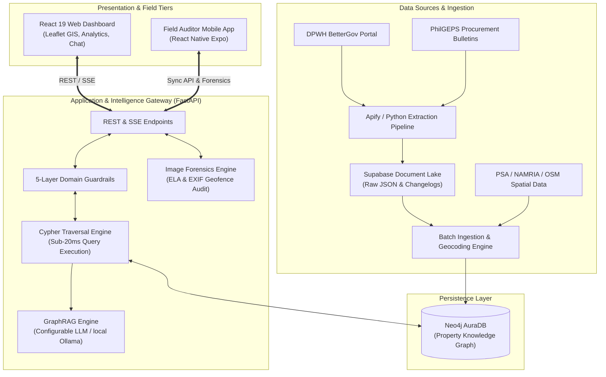
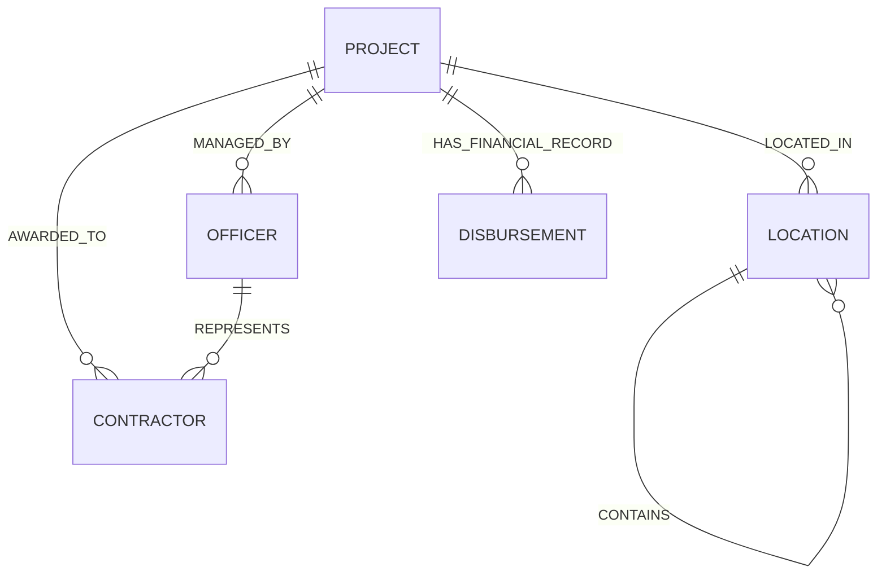
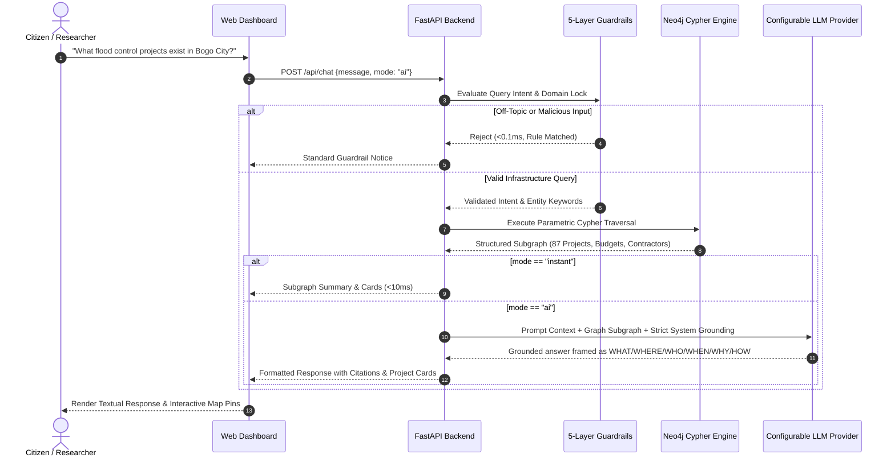
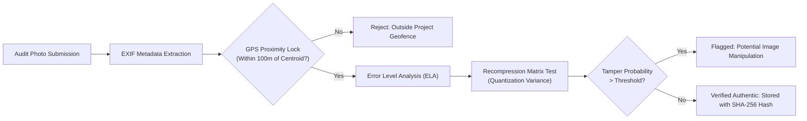

# 02. System Architecture and Pipelines

This document provides a comprehensive technical overview of the ProjectTrack platform architecture, data ingestion pipelines, knowledge graph topology, GraphRAG query execution flow, and image forensics subsystem.

---

## 1. High-Level Architecture Topology

ProjectTrack follows a decoupled client-server architecture centered around a high-performance graph database and domain-guarded intelligence engine. The platform ingests disparate public infrastructure records, transforms them into a unified property graph, and exposes structured APIs for web GIS and field auditing clients.



---

## 2. Knowledge Graph Schema and Data Model

The core relational backbone is implemented in **Neo4j AuraDB**, structured as a labeled property graph. Unlike traditional flat relational tables, the graph natively models multi-hop relationships between infrastructure projects, corporate contractors, municipal locations, and government personnel.

### 2.1 Graph Nodes and Labels

* **`Project`**: Represents an individual DPWH infrastructure undertaking.
  * *Properties*: `id`, `name`, `category`, `budget`, `status`, `year`, `district`, `contract_id`, `completion_percentage`, `source_url`.
* **`Contractor`**: Corporate entity awarded the civil works contract.
  * *Properties*: `name`, `license_no`, `classification`, `address`, `total_awarded_budget`.
* **`Location`**: Administrative spatial entity within Cebu Province.
  * *Properties*: `name`, `type` (`Municipality`, `Component City`, `HUC`, `Barangay`), `latitude`, `longitude`, `district_no`.
* **`Officer`**: DPWH district engineers, project managers, and authorized managing officers (AMOs).
  * *Properties*: `name`, `role`, `office`.
* **`Disbursement`**: Financial tranches, budget allocations, and audited expenditures.
  * *Properties*: `tranche_id`, `amount`, `date`, `funding_source`, `status`.

#### Enriched Transparency Nodes (PhilGEPS + GAA)

The ingestion pipeline augments the core graph with public procurement and
budget provenance pulled from the BetterGov search backend (`dpwh`, `philgeps`,
and `gaa` indexes). The implemented node labels and relationships are:

* **`FundingSource`**: Source of funds / program backing a project.
  * `(:Project)-[:FUNDED_BY]->(:FundingSource)`
* **`Procurement`**: A PhilGEPS procurement/bidding award. Linked conservatively
  (awardee-name match **and** Cebu `area_of_delivery`), carrying
  `match_confidence = "exact_name_cebu"` and never overwriting DPWH facts.
  * `(:Contractor)-[:AWARDED]->(:Procurement)-[:PROCURED_BY]->(:Organization)`
  * *Properties*: `reference_id`, `award_title`, `notice_title`, `contract_amount`, `award_date`, `award_status`, `business_category`, `match_confidence`.
* **`Appropriation`**: A GAA (General Appropriations Act) budget line item for a
  DPWH Cebu district office.
  * `(:Office)-[:APPROPRIATED_UNDER]->(:Appropriation)`
  * *Properties*: `amount`, `year`, `sub_object`, `fund_subcat`, `expense_class`.

Enriched `Project` properties: `amount_paid` (disbursement), `source_of_funds`,
`program_name`, `component_categories`, `region`, `report_count`,
`has_satellite_image`, and authentic `latitude`/`longitude` (`gps_source`).

### 2.2 Relationship Topology



### 2.3 Cypher Schema Constraints and Indexing

To achieve sub-20ms traversals and real-time full-text search across 4,370+ projects, the following indexes and constraints are enforced in Neo4j:

```cypher
// Uniqueness constraints
CREATE CONSTRAINT unique_project_id IF NOT EXISTS
FOR (p:Project) REQUIRE p.id IS UNIQUE;

CREATE CONSTRAINT unique_contractor_name IF NOT EXISTS
FOR (c:Contractor) REQUIRE c.name IS UNIQUE;

// Full-text search indexes
CREATE FULLTEXT INDEX projectSearchIndex IF NOT EXISTS
FOR (p:Project) ON EACH [p.name, p.id, p.category];

CREATE FULLTEXT INDEX locationSearchIndex IF NOT EXISTS
FOR (l:Location) ON EACH [l.name];
```

---

## 3. GraphRAG Query and Reasoning Pipeline

ProjectTrack implements a hybrid Retrieval-Augmented Generation (GraphRAG) architecture. When a user submits a natural language question, the system retrieves deterministic graph subgraphs before passing grounded context to the language model.



### 3.1 Five-Layer Domain Guardrails

To prevent hallucination, jailbreaks, and resource exhaustion on third-party LLMs, the platform implements a five-tier deterministic guardrail prior to invoking the database or the model:

1. **Layer 1: Persona and System Override Defense (`<0.05ms`)**:
   Detects prompt injections, jailbreak patterns (`ignore previous instructions`, `act as a poet`), and encoding attacks.
2. **Layer 2: Generic Knowledge Interception (`<0.05ms`)**:
   Filters general dictionary queries, programming problems, mathematics exercises, and general conversational filler before reaching external APIs.
3. **Layer 3: Geographic and Administrative Boundary Lock**:
   Ensures queries remain constrained within Cebu Province, its constituent LGUs, and Philippine DPWH infrastructure domains.
4. **Layer 4: Parametric Subgraph Extraction**:
   Translates recognized entities into parameterized, safe Cypher queries to eliminate Cypher injection risks.
5. **Layer 5: Fact-Grounded Synthesis Validation**:
   Enforces strict context boundaries in the LLM prompt (provider-agnostic; the vendor is configured server-side and never surfaced in the UI), mandating that the model answer solely from the retrieved graph data — organized around the project's WHAT / WHERE / WHO / WHEN / WHY / HOW — and return a refusal if the facts are absent. The model must not substitute or embellish with outside/real-world knowledge about named landmarks.

---

## 4. Image Forensics and Ground-Truth Verification

The mobile auditing client and web submission pipelines incorporate automated digital forensics to protect against fraudulent on-site reporting.



### 4.1 Error Level Analysis (ELA)
When an image is saved in JPEG format, an 8x8 pixel grid undergoes discrete cosine transform (DCT) quantization. If regions of an image are modified (e.g., photoshopping construction equipment or pasting signboards), those specific regions degrade at differing error rates upon recompression. ProjectTrack calculates the absolute pixel difference between the uploaded image and a standardized recompressed instance to generate an error heat map.

### 4.2 Geofence Spatial Verification
Every project record in Neo4j includes latitude and longitude centroids determined via official procurement disclosures and geocoding. When an auditor takes a photo via the mobile client, the hardware GPS coordinates and accuracy radius are cross-referenced using the Haversine spherical distance metric:

$$d = 2r \arcsin\left(\sqrt{\sin^2\left(\frac{\Delta\phi}{2}\right) + \cos(\phi_1)\cos(\phi_2)\sin^2\left(\frac{\Delta\lambda}{2}\right)}\right)$$

If $d > 150\text{ meters}$, the submission is blocked from real-time verified status (marked as unverified) until on-site proximity criteria are satisfied.

---

## 5. Mobile Offline Synchronization Protocol

Field monitoring frequently occurs in areas with limited or intermittent cellular connectivity. The mobile architecture implements a local-first offline queue:

1. **Local Journaling**: Audit logs, geocoded photos, and observation forms are stored locally in an encrypted SQLite database via `expo-sqlite` and `expo-file-system` on the mobile device.
2. **Idempotency Fingerprinting**: Each submission generates a unique UUIDv4 and SHA-256 payload checksum (via `expo-crypto`) to avoid duplicate insertions during unstable connection retries.
3. **Background Synchronizer**: An OS-level background task managed via `expo-task-manager` and `expo-background-fetch` monitors network state changes. Upon detecting a verified internet connection, queued records are dispatched in transactional batches to `POST /api/pipeline/audit-sync`.
4. **Server Re-conciliation**: The backend verifies signatures, executes ELA forensics, commits valid records to the database, and returns acknowledgment receipts to purge the mobile queue.
