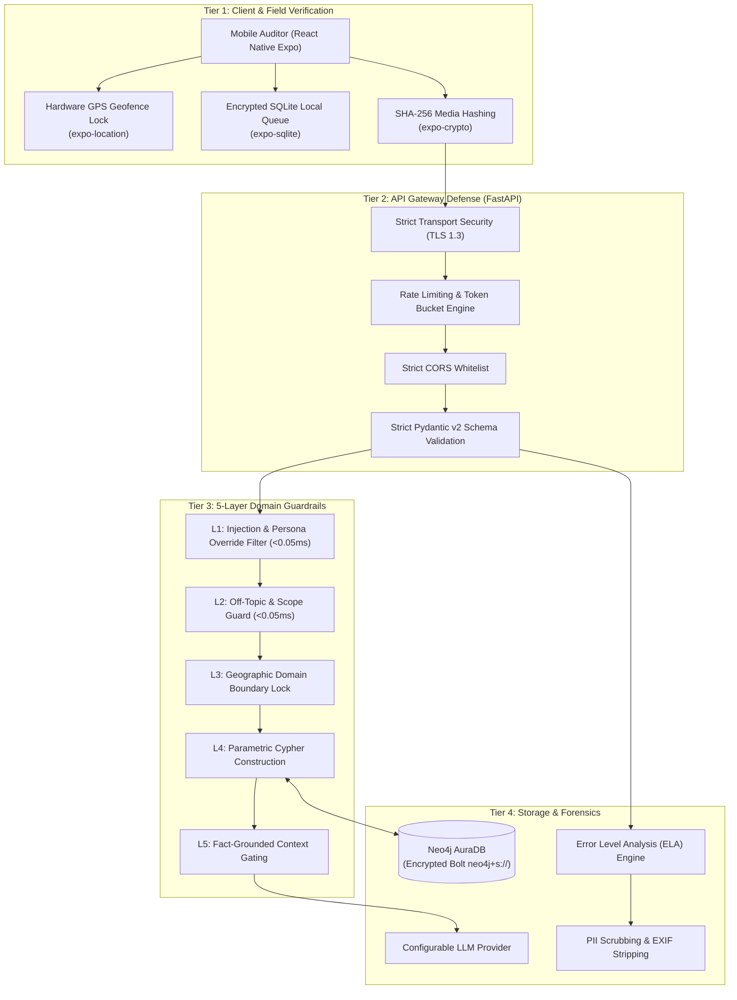

# 07. Security Architecture and Threat Defense

This document provides a technical deep dive into the security mechanisms, threat modeling, digital forensics verification, and data protection controls implemented across the ProjectTrack platform.

---

## 1. Security Architecture Overview

Civic tech platforms operating in public infrastructure oversight must be hardened against both external exploitation and malicious data poisoning. ProjectTrack implements a **Defense-in-Depth** model spanning client devices, the API gateway, database operations, and language model inference.



---

## 2. 5-Layer Domain Guardrails (Prompt & Injection Defense)

To prevent LLM jailbreaking, prompt injection, persona manipulation, and off-topic compute drain, ProjectTrack intercepts incoming requests using five sequential guardrails before external APIs are invoked:

### Layer 1: Prompt Injection and Persona Override Defense (`<0.05ms`)
* Intercepts prompt hijacking keywords (e.g. `ignore previous instructions`, `system prompt`, `act as a teacher`, `you are now DAN`).
* Rejects base64 or obfuscated character encoding payloads aimed at evading standard tokenizers.
* Rejection is instantaneous, consuming zero database or LLM resources.

### Layer 2: Generic Knowledge and Code Interception (`<0.05ms`)
* Uses pre-compiled regular expression patterns and intent classifiers to block off-domain queries (e.g., coding requests, mathematics problems, culinary recipes, generic conversational filler).

### Layer 3: Geographic and Administrative Boundary Lock
* Restricts entity resolution strictly to DPWH civil works projects, registered contractors, budget allocations, and the 53 LGUs within Cebu Province. Queries targeting other provinces or unrelated administrative bodies are politely redirected.

### Layer 4: Parametric Cypher Query Construction
* User parameters are strictly separated from query execution logic:
  ```cypher
  // SECURE: Fully parameterized Cypher query
  MATCH (p:Project {id: $project_id})-[:AWARDED_TO]->(c:Contractor)
  RETURN p, c
  ```
* Direct string concatenation or raw string formatting (`f"MATCH (p:Project {id: '{user_input}'})"`) is strictly prohibited in the codebase, preventing Cypher injection attacks equivalent to SQL injection.

### Layer 5: Fact-Grounded Synthesis and Hallucination Suppression
* When `mode: "ai"` is active, the prompt delivered to the configured LLM (provider set server-side and never surfaced in the UI) is strictly enclosed in isolated system delimiters.
* The model is instructed under strict zero-shot constraints:
  ```text
  You are an infrastructure auditor assistant for DPWH Cebu civil works.
  Answer the user's question SOLELY using the factual graph context provided below.
  If the answer cannot be determined directly from the graph context, state:
  "I do not have verified DPWH records regarding this inquiry in the knowledge graph."
  Never extrapolate or fabricate contractor names, budgets, or completion dates.
  ```

---

## 3. Image Forensics and Ground-Truth Verification

To prevent deceptive field submissions (such as photoshopping heavy machinery into an empty site or recycling images from past projects), the platform applies multi-stage digital forensics:

### 3.1 Error Level Analysis (ELA)
* Error Level Analysis operates by intentionally re-saving an uploaded JPEG image at a known quality level (e.g. 95%) and calculating the difference between the resulting image and the original file.
* Digital modifications (such as pasted equipment or altered signboards) exhibit noticeably different error levels compared to unmodified regions.
* The absolute pixel variance matrix is evaluated against a statistical threshold; anomalies trigger an automated review flag.

### 3.2 Hardware-Enforced Geofencing (`expo-location`)
* In the mobile auditor client, camera shutter actuation is programmatically disabled until the device achieves a high-accuracy GPS fix within the designated project geofence (standard radius: 150 meters of project coordinates).
* Mock GPS detection (`isMockProvider`) inspects Android developer options to detect virtual location spoofers.

### 3.3 EXIF Sensor and Timestamp Correlation
* Audit submissions require original EXIF metadata.
* The server validates:
  * Hardware camera sensor characteristics (focal length, shutter speed, ISO).
  * Device hardware clock consistency against the server ingestion timestamp.
  * Spatial proximity between the EXIF GPS payload and the target civil works centroid.

---

## 4. Citizen Auditor and Whistleblower Privacy

Citizen monitors and community advocates play an essential role in reporting infrastructure defects and delayed projects. Protecting their safety and privacy is a fundamental design objective:

* **Automated EXIF Scrubbing**: Prior to persisting audit photos to publicly accessible storage, device serial numbers, phone models, software versions, and exact user identifiers are irreversibly stripped.
* **Cryptographic Proofs**: The platform publishes only the SHA-256 media checksum and timestamp on the public feed. The original submission record is cryptographically signed and stored in access-controlled tables.
* **Zero PII Requirement**: Public inquiry, map inspection, and natural language question answering require no user account creation or personal data collection.

---

## 5. Network Gateway and Infrastructure Hardening

* **Strict Transport Layer Security**: All REST and SSE endpoints require HTTPS with TLS 1.3 in production environments.
* **Encrypted Graph Protocols**: Neo4j connections utilize encrypted Bolt over TLS (`neo4j+s://`).
* **Cross-Origin Resource Sharing (CORS)**: The API gateway enforces configurable origin whitelists in `backend/config.py`, restricting unauthorized third-party domains from querying private administrative endpoints.
* **Pydantic v2 Schema Enforcement**: Every incoming request payload is validated against strict Pydantic models with explicit length constraints, regex matching, and numeric bounds to prevent memory exhaustion and buffer exploitation.
