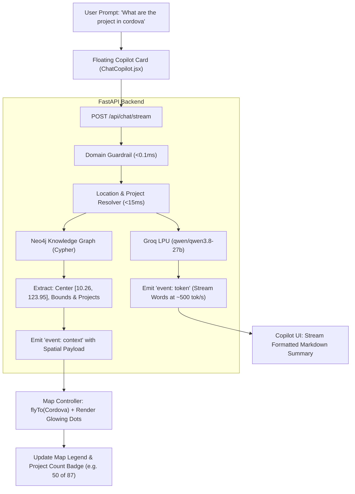

# Implementation Plan: Interactive AI Chatbot with Synchronized Map Zooming & Spatial Dots

## Goal Description
Transform the DPWH Cebu Knowledge Graph AI into an **Interactive Spatial Copilot**. When a user prompts with a location query like *"What are the projects in Cordova"*, the system will:
1. **Immediately resolve spatial intent (<15ms)** in the backend and emit a `spatial_context` event containing municipality coordinates, bounds, and project coordinates.
2. **Smoothly fly/zoom the Leaflet map** to the target municipality (e.g., Cordova) while the AI is thinking/streaming.
3. **Dynamically render interactive project dots** on the map with status-coded colors and pulsing animations.
4. **Provide a Density Filter Toggle** on the map: Default to **Top 50 (Fast & Clean)** with a seamless one-click option to **Show All Projects** (e.g., all 195 projects in Toledo).
5. **Display an Interactive Map Legend** overlay showing status color codes (Emerald = Completed, Pulsing Amber = Ongoing, Cyan = Bidding/Planning).
6. **Stream grounded AI engineering insights** in real time (via the server-configured LLM provider) into a modern **Floating Assistant Card** ("ProjectTrack Watchdog") overlaid on the map.

---

## User Review & Decisions Confirmed

> [!NOTE]
> **User Choices Locked In**:
> 1. **Chatbot Interface Style**: **Floating Copilot Card** (sleek, glassmorphic widget floating in the bottom-right corner over the map, collapsible to an `Ask AI` button).
> 2. **Project Dot Density Option**: Default to top 50 projects for instant 60fps rendering, with a prominent **"Show All (X) Projects"** toggle option on the map.
> 3. **Status-Coded Glowing Pins & Legend**:
>    - **Emerald Green (`#10b981`)**: Completed (100%)
>    - **Pulsing Amber (`#f59e0b`)**: Ongoing (in construction)
>    - **Electric Cyan (`#06b6d4`)**: Bidding / Procurement / Planning
>    - **Muted Slate (`#94a3b8`)**: Other / Unspecified
>    - **On-Map Legend**: Elegant translucent glass badge (bottom-left) explaining each status tone, with click-to-filter capability.

---

## System Architecture



---

## Proposed Changes

### Backend Components

#### [MODIFY] [`backend/models/chat.py`](../backend/backend/models/chat.py)
- Extend `ChatResponse` and context models to include `spatial` metadata:
  ```python
  class SpatialProjectPoint(BaseModel):
      id: str
      description: str
      budget: Optional[str] = None
      budget_numeric: Optional[float] = None
      status: Optional[str] = None
      contractor: Optional[str] = None
      category: Optional[str] = None
      latitude: float
      longitude: float
      formatted_address: Optional[str] = None

  class SpatialContext(BaseModel):
      target_location: Optional[str] = None
      center: Optional[List[float]] = None  # [lat, lng]
      zoom: Optional[int] = None
      total_count: int = 0
      projects: List[SpatialProjectPoint] = []
  ```

#### [MODIFY] [`backend/api/chat.py`](../backend/backend/api/chat.py)
- In `resolve_project_context`:
  - When a location (e.g. `Cordova`, `Mandaue`, `Bogo`) is recognized, extract its center coordinates and top geocoded project coordinates from Neo4j.
  - Return `spatial_context` including `total_count` (e.g. 195 total in Toledo) and initial top 50 project coordinates.
  - Include `spatial` in `context_payload` emitted via `event: context` in `/api/chat/stream` and `/api/chat`.

---

### Frontend Components (Website)

#### [NEW] [`ChatCopilot.jsx`](../Website/src/features/chat/ChatCopilot.jsx)
- **Floating Glassmorphic Card** positioned in the bottom-right corner over the map:
  - Header: `ProjectTrack Watchdog` with an `Online` status badge (no provider/vendor identifier surfaced), Minimize/Expand button, and Clear Chat.
  - Collapsed State: Sleek floating pill button: `Ask ProjectTrack Watchdog`.
  - Message Stream: Real-time SSE token streaming, markdown formatting, and interactive Project ID chips (`24HN0012`) that highlight the dot on the map when clicked.
  - Quick-Prompt Suggestion Pills (emoji-free for a professional tone):
    - `Projects in Cordova`
    - `Top projects in Mandaue`
    - `Flood mitigation in Cebu City`
    - `Most reported in Cebu`
    - `Tell me about 24HH0043`
  - Input field with automatic focus, send button, and loading spinner.

#### [NEW] [`MapContext.jsx`](../Website/src/features/map/MapContext.jsx)
- State management provider coordinating Map and Chatbot:
  - `activeLocation`: Current municipality name (e.g. `"Cordova"`).
  - `cameraTarget`: `[lat, lng]` and `zoom` for smooth `map.flyTo()`.
  - `projectDots`: List of geocoded projects to render as dots.
  - `totalLocationProjects`: Total project count in that LGU (e.g. 195).
  - `displayMode`: `'top50'` vs `'all'`.
  - `activeStatusFilter`: Filter by status (`all`, `completed`, `ongoing`, `procurement`).
  - `selectedProject`: Detailed card popover for clicked dot.
  - `loadAllProjects(municipality)`: Function calling backend `GET /api/projects/map?municipality=...&limit=2000` to seamlessly switch from top 50 to all projects!

#### [NEW] [`MapLegend.jsx`](../Website/src/features/map/MapLegend.jsx)
- Glassmorphic legend overlay anchored in the bottom-left corner of the map:
  - **Completed**: `#10b981` (Solid emerald dot)
  - **Ongoing**: `#f59e0b` (Pulsing amber dot)
  - **Bidding / Planning**: `#06b6d4` (Cyan dot)
  - Displays dynamic project count badge:
    `Showing 50 of 195 projects in Toledo` + interactive toggle button: `[Show All 195]` / `[Show Top 50]`.
  - Clickable status items to filter visible dots on the map (e.g. click "Ongoing" to isolate active construction sites).

#### [MODIFY] [`CebuMap.jsx`](../Website/src/features/map/CebuMap.jsx)
- Connect to `MapContext`:
  - `MapCameraController`: Listens for `cameraTarget` changes and executes `map.flyTo(target, zoom, { duration: 1.5, easeLinearity: 0.25 })`.
  - Render status-colored project dots with rich interactive Tooltips and Popups on click.
  - Highlight active municipality polygon in GeoJSON with a glowing outline and soft fill tint.
  - Embed `MapLegend` overlay inside the map container.

#### [MODIFY] [`HomePage.jsx`](../Website/src/pages/HomePage.jsx)
- Wrap page in `<MapProvider>`.
- Embed `<ChatCopilot />` floating over `<CebuMap />`.

#### [MODIFY] [`index.css`](../Website/src/index.css)
- Add CSS animations and glowing tones for status dots:
  ```css
  .pin--emerald {
    background: #10b981;
    box-shadow: 0 0 10px rgba(16, 185, 129, 0.6);
  }
  .pin--amber {
    background: #f59e0b;
    animation: pin-glow-amber 2.2s infinite;
  }
  .pin--cyan {
    background: #06b6d4;
    box-shadow: 0 0 10px rgba(6, 182, 212, 0.6);
  }
  .pin--slate {
    background: #94a3b8;
  }
  ```

---

## Verification Plan

### Automated Tests
1. **Backend Integration Tests**:
   Verify `/api/chat` and `/api/chat/stream` return `spatial` data with coordinates for location queries:
   ```powershell
   python -m unittest backend.tests.test_api
   ```
2. **Frontend Production Build**:
   Verify Vite compiles all new components cleanly without linting or bundling errors:
   ```powershell
   npm run build
   ```

### Manual Verification
1. **Camera Zoom & Dot Display**:
   - In `ChatCopilot`, click the `"Projects in Cordova"` quick chip or type `"What are the projects in cordova"`.
   - Verify the map immediately flies smoothly to Cordova.
   - Verify Cordova's boundary is highlighted and project dots appear.
   - Verify the AI streams the engineering summary in the Copilot card.
2. **Density Toggle (Top 50 vs Show All)**:
   - Ask for a high-volume area (e.g. `"Projects in Toledo"` with 195 projects).
   - Verify initial display shows Top 50 with badge `"Showing 50 of 195 projects"`.
   - Click `"Show All 195"` button — verify all 195 dots populate the map.
3. **Map Legend & Status Filters**:
   - Verify the bottom-left legend shows Completed (Emerald), Ongoing (Amber), Bidding (Cyan).
   - Click "Ongoing" on the legend — verify only ongoing projects are highlighted.
4. **Interactive Dot Cards**:
   - Click a project dot on the map — verify popup shows ID, budget, contractor, and "Ask AI" button.
5. **Floating Copilot Usability**:
   - Click the minimize button `—` — verify card collapses to a floating pill.
   - Click the pill — verify card expands smoothly with conversation intact.
